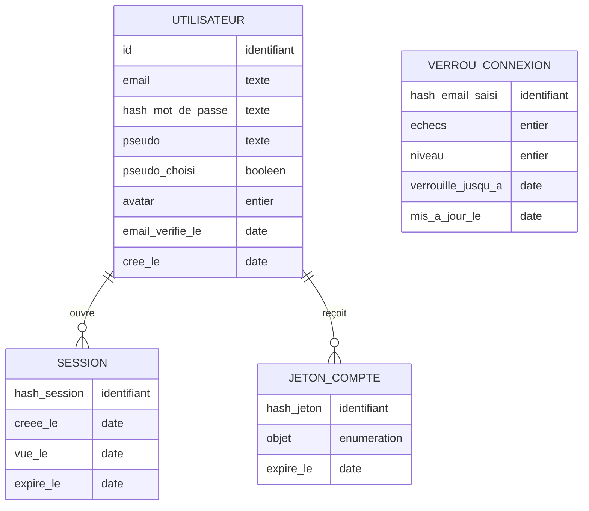
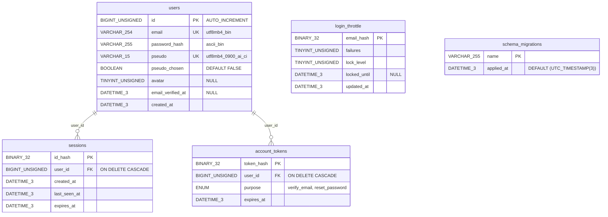
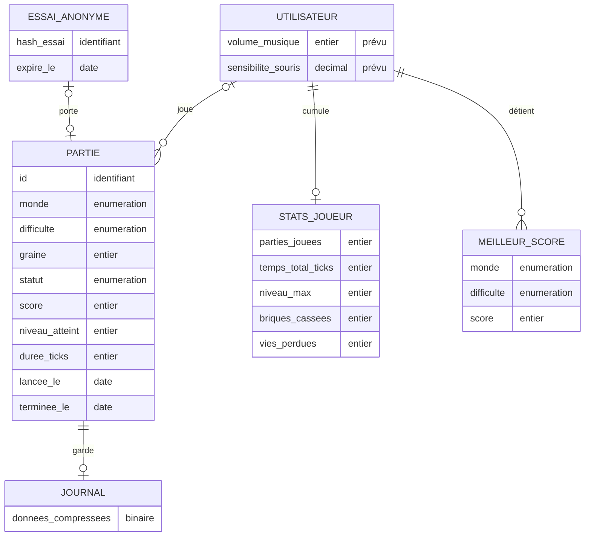

# Modèle de données — méthode Merise

Schéma MySQL de l'API (`apps/api`). Les tables des comptes existent : leur MPD reprend exactement `apps/api/migrations/0001_create_accounts.sql`. Les parties, scores et stats sont **prévus** : leur modèle découle de [`cadrage.md`](cadrage.md) (§ Scores et classements, § Stats) et changera à leur implémentation.

Base : MySQL 8.0, InnoDB, jeu de caractères par défaut `utf8mb4`, collation `utf8mb4_0900_ai_ci`. Toutes les dates sont écrites en UTC par l'API (le pilote est réglé sur `timezone: "Z"`, `apps/api/src/db.ts`) ; MySQL ne l'impose pas.

## 1. Dictionnaire de données (comptes)

| Donnée | Signification | Type | Règle |
|---|---|---|---|
| id utilisateur | Identifiant technique du compte | entier | attribué par la base |
| email | Adresse du compte, en minuscules | texte ≤ 254 | unique, comparé octet à octet |
| hash du mot de passe | `scrypt$<log2 N>$<r>$
$<sel>$<hash>` | texte ASCII ≤ 255 | jamais le mot de passe en clair |
| pseudo | Nom affiché dans les tables | texte ≤ 15 | unique sans tenir compte de la casse ni des accents ; provisoire `JoueurNNNNN` à l'inscription |
| pseudo choisi | Le joueur a remplacé le pseudo provisoire | booléen | faux à la création |
| avatar | Index dans la galerie (10 avatars) | entier 0–9 | vide tant que le joueur n'a pas choisi |
| email vérifié le | Date du clic sur le lien de vérification | date | vide : compte non vérifié, supprimé après 7 jours |
| créé le | Date d'inscription | date | |
| hash de session | SHA-256 de l'identifiant aléatoire du cookie `__Host-sid` | 32 octets | le cookie seul ne se retrouve pas en base |
| session vue le | Dernière requête de la session | date | inactivité > 7 jours : session close |
| session expire le | Fin absolue, création + 30 jours | date | |
| hash du jeton | SHA-256 du jeton d'un lien envoyé par email | 32 octets | usage unique : la ligne est supprimée à l'usage |
| objet du jeton | Vérification d'email ou réinitialisation du mot de passe | énumération | lien valable 24 h (vérification) ou 1 h (réinitialisation) |
| jeton expire le | Fin de validité du lien | date | |
| hash de l'email saisi | SHA-256 de l'email tapé à la connexion, compte existant ou non | 32 octets | ne révèle pas quels emails ont un compte |
| échecs | Échecs de connexion depuis le dernier verrou | entier | verrou au 5ᵉ |
| niveau de verrou | Nombre de verrous déjà posés (0 à 3) | entier | durées 1, 5 puis 15 minutes |
| verrouillé jusqu'à | Fin du verrou en cours | date | vide : pas de verrou |
| verrou mis à jour le | Dernier échec | date | oublié après 24 h sans échec |

Aucune adresse IP n'est stockée : la limitation de débit par IP vit en mémoire seulement (RGPD, minimisation).

## 2. MCD (comptes)

| Association | Côté | Cardinalité | Lecture |
|---|---|---|---|
| ouvre | UTILISATEUR | 0,n | un compte a aucune ou plusieurs sessions (un appareil chacune) |
| ouvre | SESSION | 1,1 | une session appartient à un seul compte |
| reçoit | UTILISATEUR | 0,n | un compte a aucun ou plusieurs liens en cours |
| reçoit | JETON_COMPTE | 1,1 | un lien concerne un seul compte |

**VERROU_CONNEXION n'est reliée à aucune entité, volontairement.** Elle est identifiée par le hash de l'email *saisi*, qu'un compte existe ou non. La relier à UTILISATEUR obligerait à ne verrouiller que les emails inscrits, et un verrou trahirait alors l'existence d'un compte (cadrage, § Sécurité, messages neutres).

## 3. MLD (comptes)

Notation : clé primaire **en gras**, clé étrangère précédée de `#`.

- users (**id**, email, password_hash, pseudo, pseudo_chosen, avatar, email_verified_at, created_at)
- sessions (**id_hash**, #user_id, created_at, last_seen_at, expires_at)
- account_tokens (**token_hash**, #user_id, purpose, expires_at)
- login_throttle (**email_hash**, failures, lock_level, locked_until, updated_at)

Les deux associations 0,n – 1,1 deviennent chacune une clé étrangère `user_id` du côté 1,1. Aucune association n,n, donc aucune table de liaison.

## 4. MPD (comptes)

Toutes les colonnes sont `NOT NULL` sauf celles marquées `NULL`. Toutes les tables sont en InnoDB.

### Index et contraintes

| Table | Nom | Colonnes | Sorte | Sert à |
|---|---|---|---|---|
| users | PRIMARY | id | clé primaire | |
| users | users_email | email | unique | connexion, unicité de l'email |
| users | users_pseudo | pseudo | unique | unicité du pseudo, insensible à la casse et aux accents |
| users | users_unverified | email_verified_at, created_at | index | purge des comptes non vérifiés après 7 jours |
| sessions | PRIMARY | id_hash | clé primaire | lecture de la session à chaque requête |
| sessions | sessions_user | user_id | index | déconnexion de tous les appareils |
| sessions | sessions_expiry | expires_at | index | purge des sessions expirées |
| sessions | sessions_user_fk | user_id → users.id | clé étrangère, `ON DELETE CASCADE` | suppression du compte |
| account_tokens | PRIMARY | token_hash | clé primaire | lecture du lien cliqué |
| account_tokens | account_tokens_user | user_id, purpose | index | un seul lien valide par objet |
| account_tokens | account_tokens_expiry | expires_at | index | purge des liens expirés |
| account_tokens | account_tokens_user_fk | user_id → users.id | clé étrangère, `ON DELETE CASCADE` | suppression du compte |
| login_throttle | PRIMARY | email_hash | clé primaire | lecture du verrou à la connexion |
| login_throttle | login_throttle_updated | updated_at | index | purge des verrous oubliés après 24 h |
| schema_migrations | PRIMARY | name | clé primaire | migrations déjà appliquées |

### Collations

- `users.email` en `utf8mb4_bin` : l'API met l'email en minuscules avant de l'écrire, la comparaison est donc exacte.
- `users.pseudo` en `utf8mb4_0900_ai_ci` : « Nova », « NOVA » et « Nóva » ne peuvent pas coexister.
- `users.password_hash` en `ascii_bin` : le hash n'est fait que de caractères ASCII.
- `users` déclare `DEFAULT CHARSET = utf8mb4 COLLATE = utf8mb4_0900_ai_ci`. Les trois autres tables de la migration et `schema_migrations` n'en déclarent pas et prennent celle de la base, la même. Seuls `account_tokens.purpose` et `schema_migrations.name` sont concernés.

`schema_migrations` est créée par l'outil de migration (`apps/api/src/migrate.ts`), pas par un fichier `.sql`.

## 5. Écarts et remarques

Le MPD ci-dessus est la migration telle quelle. Ce qui suit signale ce que la migration, le code ou le cadrage disent de différent, sans rien corriger.

1. **Corrigé.** Le § Sécurité du cadrage annonçait argon2id alors que le § Comptes et le code (`apps/api/src/auth/password.ts`) utilisent scrypt. Il dit désormais scrypt, et prévoit le passage à argon2id quand `crypto.argon2` sera stable dans Node. `users.password_hash` n'en dépend pas : le hash porte le nom de son algorithme.
2. **Décidé, à implémenter avec l'écran des réglages.** Le cadrage (§ Comptes) veut les réglages (souris, son) enregistrés sur le compte ; aucune colonne ne les porte encore. Ils deviendront deux attributs de UTILISATEUR, voir le modèle prévu.
3. **Assumé.** `users.avatar` est un `TINYINT UNSIGNED`, le plus petit entier de MySQL (un octet), qui accepte 0 à 255 ; seuls les numéros de la galerie ont une image. La limite vit dans `packages/contracts` (`AVATAR_COUNT`), seule source de vérité, et le schéma de `PUT /api/me/avatar` la fait respecter. Pas de `CHECK` : il dupliquerait la limite, et les avatars personnels prévus (§ 6) remplaceront ce numéro par une clé étrangère.
   - **Galerie à corriger dans le code** : les maquettes (haute fidélité et charte E, « Choisir un avatar ») prévoient 9 avatars en grille de 3 × 3 ; le code en compte 10 (`AVATAR_COUNT = 10`, 10 entrées dans `apps/web/src/components/Avatar.tsx`). Les 10 dessins actuels sont provisoires, aucun n'est validé : la galerie définitive en comptera 9, à créer. Sans effet sur le schéma : les numéros valides deviendront 0 à 8.
4. **Assumé.** Une session prend fin après 7 jours d'inactivité (`last_seen_at` + 7 jours, calculé par l'API, `apps/api/src/auth/sessions.ts`) ou 30 jours après sa création (`expires_at`). La purge horaire (`apps/api/src/cleanup.ts`, `expires_at <= ? OR last_seen_at <= ?`) parcourt toute la table : `last_seen_at` n'a pas d'index et le `OR` empêche d'utiliser `sessions_expiry` seul. La table ne compte qu'une ligne par appareil connecté (environ 70 Ko pour 1 000 joueurs) : le parcours coûte de l'ordre d'une milliseconde, et un index sur `last_seen_at` ne se justifierait qu'au-delà d'environ 100 000 sessions.
   - **RGPD** : la purge applique la limitation de la conservation (art. 5.1.e) ; une session périmée est effacée dans l'heure, et refusée dès qu'elle se présente, avant même la purge. Les sessions ne gardent ni IP ni navigateur. À confirmer au `/conform-cnil` avant la mise en ligne.
5. **Assumé.** Un lien utilisé est supprimé : `account_tokens` n'a ni date d'envoi ni date d'usage. Le besoin (usage unique, expiration) est couvert, et l'absence d'historique applique la minimisation (RGPD, art. 5.1.c). Un joueur qui n'a pas reçu son lien de vérification fait « mot de passe oublié » : le lien de réinitialisation vérifie aussi l'email, sans support. Le site n'aura pas de bouton « Renvoyer le lien » ; la route `/auth/resend-verification` de l'API reste sans écran.
   - **Prévu en V2.0, avec l'administration** : un historique des liens (envoyé le, utilisé le) pour que l'administrateur aide un joueur. Il prendra la forme d'une table à part, `account_token_log` (#user_id, purpose, sent_at, used_at), ou de deux colonnes `created_at` et `used_at` dans `account_tokens` avec suppression différée. Il demandera une finalité écrite et une durée de conservation courte (par exemple 30 jours), à faire valider au `/conform-cnil`.
6. **Corrigé.** `schema_migrations.applied_at` était un `TIMESTAMP`, limité au 19 janvier 2038 et écrit dans le fuseau de la session MySQL. Il est désormais en `DATETIME(3)`, rempli en UTC par la base (`DEFAULT (UTC_TIMESTAMP(3))`, `apps/api/src/migrate.ts`), comme les autres dates. Corrigé avant que la table n'existe dans aucune base : pas d'`ALTER TABLE` à prévoir.
7. **Assumé.** `purpose` est un `ENUM` : la base refuse toute sorte de lien inconnue. En ajouter une (par exemple `change_email` en V2.0) demande une migration `ALTER TABLE … MODIFY`, instantanée dans MySQL 8 tant que la nouvelle valeur est ajoutée à la fin de la liste.

## 6. Modèle prévu : parties, scores et stats

> **Prévu, non implémenté.** Tiré de `cadrage.md` (§ Parcours, § Scores et classements, § Stats). Types indicatifs ; noms, index et découpage seront fixés par la migration qui les créera.

### Règles de gestion

- RG1. Chaque partie lancée reçoit du serveur une graine ; le client renvoie le journal de ses entrées ; le serveur rejoue et ne garde que son propre résultat.
- RG2. Chaque partie validée, quel que soit le monde (espace, arcade, Limbes), donne une ligne : monde, difficulté, score, niveau atteint, durée, date.
- RG3. La partie d'essai (espace, moyen) n'a pas de compte : elle est rattachée à une session anonyme et expire si le joueur ne s'inscrit pas ; s'il s'inscrit, elle passe à son compte.
- RG4. Espace et arcade : tables privées par monde et par difficulté, visibles du seul joueur.
- RG5. Limbes : un classement par difficulté, partagé ; plusieurs entrées par joueur ; la base en garde les 1000 meilleures, le site affiche les 100 premières.
- RG6. Le journal d'entrées est supprimé après validation, sauf pour les scores du top 1000 du Limbes.
- RG7. Une ligne de compteurs par joueur, mise à jour à chaque partie : parties jouées, temps total, meilleur score par monde et par difficulté, niveau maximal, briques cassées, vies perdues.
- RG8. Les réglages du joueur sont enregistrés sur son compte.

### MCD prévu

Seuls les attributs ajoutés à UTILISATEUR sont montrés ; les siens sont au § 2.

| Association | Cardinalités | Remarque |
|---|---|---|
| joue | UTILISATEUR 0,n — PARTIE 0,1 | 0,1 côté partie : la partie d'essai n'a pas de compte avant l'inscription (RG3) |
| porte | ESSAI_ANONYME 0,1 — PARTIE 0,1 | une session anonyme, une seule partie d'essai |
| garde | PARTIE 0,1 — JOURNAL 1,1 | journal gardé pour le top 1000 du Limbes seulement (RG6) |
| cumule | UTILISATEUR 0,1 — STATS_JOUEUR 1,1 | créée à la première partie |
| détient | UTILISATEUR 0,n — MEILLEUR_SCORE 1,1 | une ligne par monde et difficulté joués (RG7) |

Les réglages (RG8) ne forment pas une entité : un compte en a une valeur de chaque, qui ne dépend que de lui. Ce sont des attributs de UTILISATEUR.

### MLD prévu

- games (**id**, #user_id, #trial_hash, world, difficulty, seed, status, score, level, duration_ticks, started_at, ended_at)
- trial_sessions (**id_hash**, expires_at)
- replay_logs (**#game_id**, log)
- player_stats (**#user_id**, games_played, total_ticks, max_level, bricks_broken, lives_lost)
- player_bests (**#user_id, world, difficulty**, best_score)
- users : ajout de music_volume, mouse_sensitivity

### MPD prévu des réglages

| Colonne | Type | Règle |
|---|---|---|
| users.music_volume | `TINYINT UNSIGNED NULL` | 0 à 64, l'échelle du jeu (`MAX_VOLUME`, `packages/game/src/audio/rules.ts`) |
| users.mouse_sensitivity | `DECIMAL(3,2) NULL` | 0,10 à 3,00 (`packages/game/src/ui/settings.ts`) |

`NULL` vaut « défaut du jeu » (volume 32, sensibilité 0,5) : un défaut changé plus tard profite aux joueurs qui n'y ont jamais touché, sans migration. Des colonnes typées plutôt qu'un document JSON : MySQL vérifie alors le type, et le modèle dit ce qui est stocké.

### Choix à trancher à l'implémentation

- **Tables privées et classement du Limbes sans table dédiée** : ce sont des lectures de `games` (statut validé) triées par score, servies par un index `(world, difficulty, score)` pour le Limbes et `(user_id, world, difficulty, score)` pour les tables privées. Le plafond de 1000 du Limbes se tient en supprimant le journal (et éventuellement la ligne) des parties sorties du top. Une table `limbes_ranking` séparée ne vaudrait que si la lecture devenait trop lente.
- **`player_bests` contre `player_stats`** : les meilleurs scores par monde et difficulté (jusqu'à 3 × 3 valeurs) vont dans une table à part pour rester en première forme normale ; le survol d'un joueur dans le classement lit `player_stats.games_played` et le meilleur score Limbes.
- **Briques cassées et vies perdues** : le moteur ne les rend pas encore dans le résultat du rejeu (`GameEnd` de `packages/game/src/game/replay.ts` donne score, niveau et tick). Il faudra les ajouter au rejeu, puisque seul le résultat du serveur fait foi.
- **Journal** : environ 5 Ko compressé pour 7 minutes de jeu (cadrage, § Stats) ; `MEDIUMBLOB` suffit. En table à part pour que les lectures de `games` ne le chargent jamais.
- **Monde et difficulté** : `ENUM('space', 'arcade', 'limbes')` et `TINYINT` 0–2 (`Difficulty` de `packages/game/src/data/config.ts`), ou `ENUM('easy', 'medium', 'hard')`.
- **Suppression du compte** : `ON DELETE CASCADE` partout depuis `users`, comme pour les comptes ; les entrées du joueur disparaissent alors du classement du Limbes.

### Avatars personnels (V2.0, hors V2)

> **Piste, non cadrée.** Le cadrage exclut l'envoi d'images de la V2 et le range dans ses pistes, avec la messagerie et l'administration.

- avatars (**id**, kind, #owner_id, file, moderation_status, created_at) : `kind` vaut prédéfini ou envoyé ; `owner_id` est vide pour un avatar prédéfini ; `moderation_status` (en attente, accepté, refusé) n'a de sens que pour un avatar envoyé.
- users : `avatar` (numéro dans la galerie) devient `#avatar_id`, clé étrangère vers `avatars` ; les avatars prédéfinis deviennent les premières lignes de `avatars`, et la migration réécrit les numéros actuels.
- Un avatar envoyé appartient à un seul joueur (UTILISATEUR 0,n — AVATAR 0,1 par « envoie ») et un joueur en affiche un seul (UTILISATEUR 0,1 — AVATAR 0,n par « affiche »). À la suppression du compte, ses images sont supprimées avec lui (donnée personnelle).
