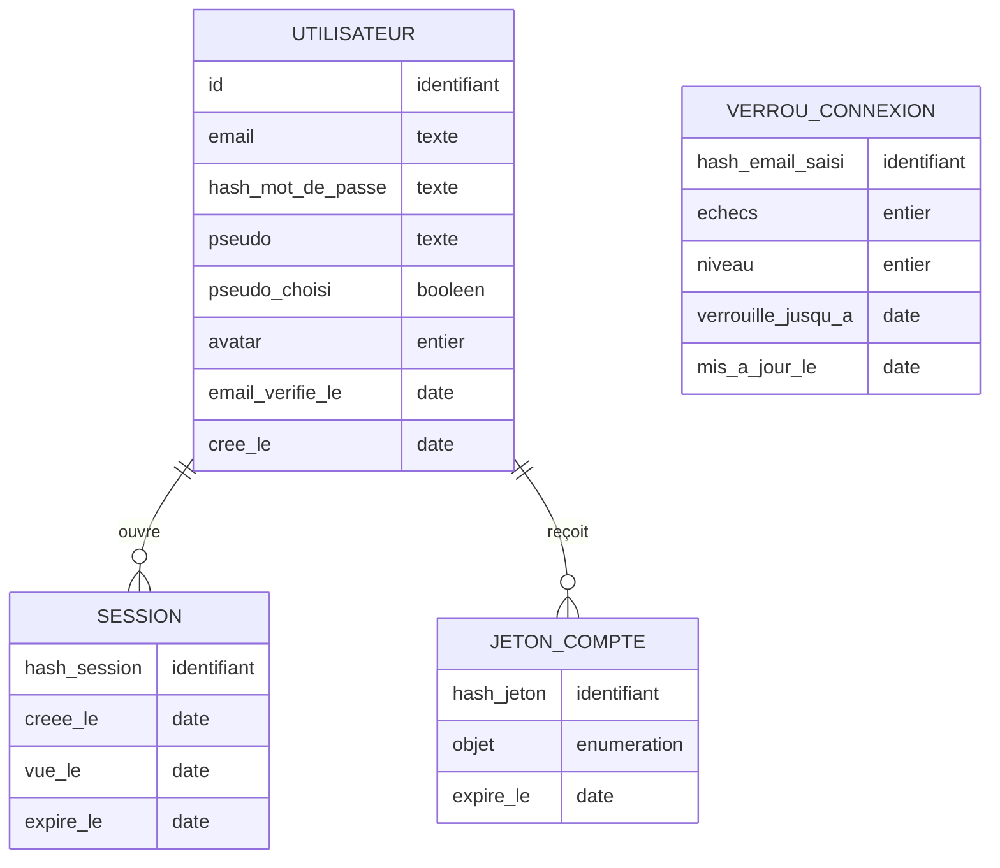
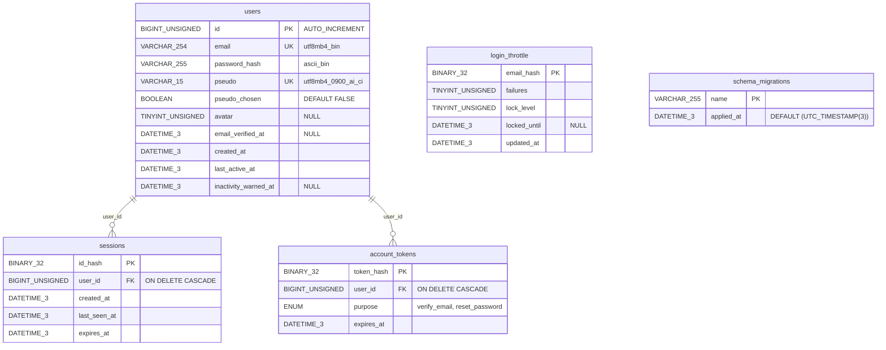
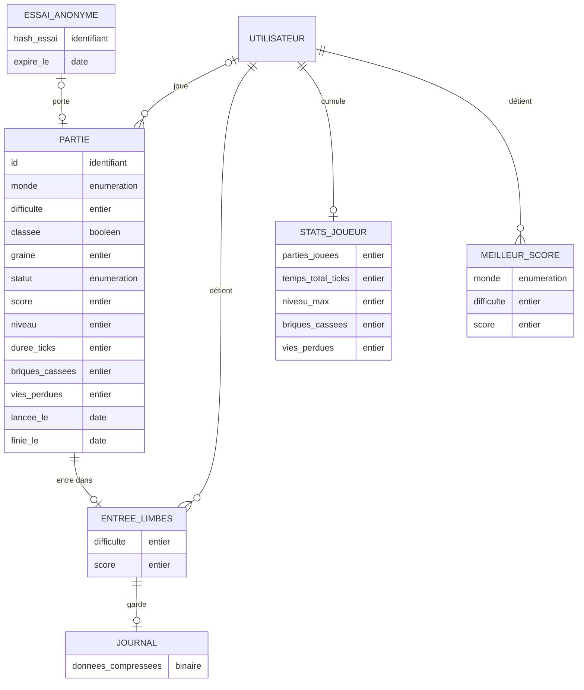
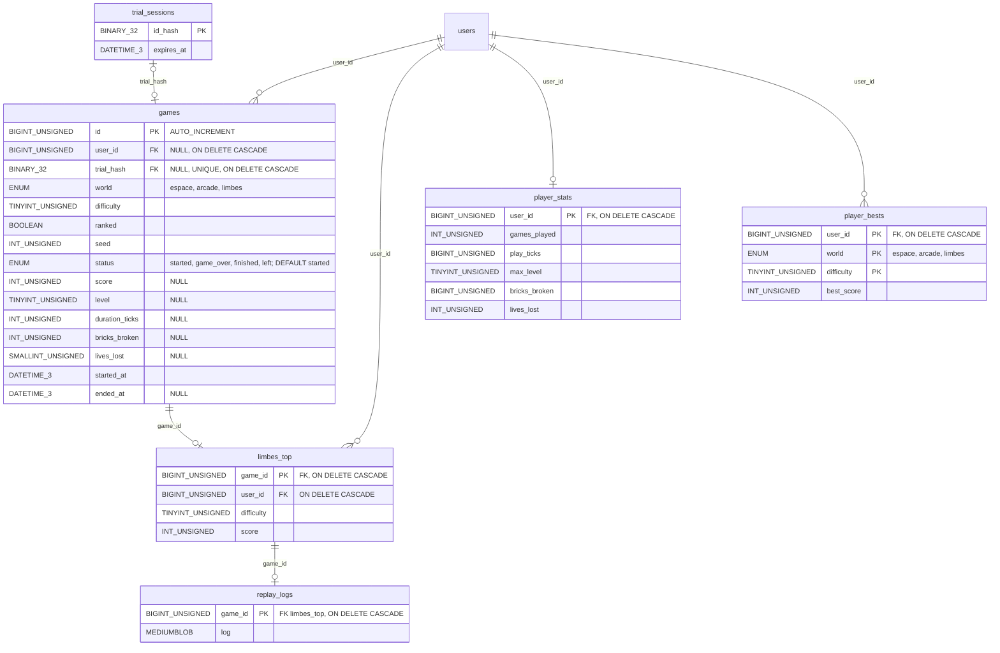

# Modèle de données — méthode Merise

Schéma MySQL de l'API (`apps/api`). Les tables des comptes (§ 1 à 5) reprennent exactement `apps/api/migrations/0001_create_accounts.sql`, celles des parties, scores et stats (§ 6) `0002_create_games.sql`, tirées de [`cadrage.md`](cadrage.md) (§ Scores et classements, § Stats). Les réglages (§ 7) sont deux colonnes de `users` ajoutées par `0003_add_user_settings.sql` ; la date de dernière activité et l'avertissement avant suppression des comptes inactifs (§ 9) sont deux colonnes de `users` ajoutées par `0004_track_account_activity.sql` ; les avatars personnels (§ 8) sont prévus.

Base : MySQL 8.0, InnoDB, jeu de caractères par défaut `utf8mb4`, collation `utf8mb4_0900_ai_ci`. Toutes les dates sont écrites en UTC par l'API (le pilote est réglé sur `timezone: "Z"`, `apps/api/src/db.ts`) ; MySQL ne l'impose pas.

## 1. Dictionnaire de données (comptes)

| Donnée | Signification | Type | Règle |
|---|---|---|---|
| id utilisateur | Identifiant technique du compte | entier | attribué par la base |
| email | Adresse du compte, en minuscules | texte ≤ 254 | unique, comparé octet à octet |
| hash du mot de passe | `scrypt$<log2 N>$<r>$
$<sel>$<hash>` | texte ASCII ≤ 255 | jamais le mot de passe en clair |
| pseudo | Nom affiché dans les tables | texte ≤ 15 | unique sans tenir compte de la casse ni des accents ; provisoire `JoueurNNNNN` à l'inscription |
| pseudo choisi | Le joueur a remplacé le pseudo provisoire | booléen | faux à la création |
| avatar | Index dans la galerie (10 avatars) | entier 0–9 | vide tant que le joueur n'a pas choisi |
| email vérifié le | Date du clic sur le lien de vérification | date | vide : compte non vérifié, supprimé après 7 jours |
| créé le | Date d'inscription | date | |
| actif le | Dernière activité du compte (§ 9) | date | 3 ans sans activité : compte supprimé |
| averti le | Envoi de l'email d'avertissement avant suppression (§ 9) | date | vide : pas averti, ou revenu depuis |
| hash de session | SHA-256 de l'identifiant aléatoire du cookie `__Host-sid` | 32 octets | le cookie seul ne se retrouve pas en base |
| session vue le | Dernière requête de la session | date | inactivité > 7 jours : session close |
| session expire le | Fin absolue, création + 30 jours | date | |
| hash du jeton | SHA-256 du jeton d'un lien envoyé par email | 32 octets | usage unique : la ligne est supprimée à l'usage |
| objet du jeton | Vérification d'email ou réinitialisation du mot de passe | énumération | lien valable 24 h (vérification) ou 1 h (réinitialisation) |
| jeton expire le | Fin de validité du lien | date | |
| hash de l'email saisi | SHA-256 de l'email tapé à la connexion, compte existant ou non | 32 octets | ne révèle pas quels emails ont un compte |
| échecs | Échecs de connexion depuis le dernier verrou | entier | verrou au 5ᵉ |
| niveau de verrou | Nombre de verrous déjà posés (0 à 3) | entier | durées 1, 5 puis 15 minutes |
| verrouillé jusqu'à | Fin du verrou en cours | date | vide : pas de verrou |
| verrou mis à jour le | Dernier échec | date | oublié après 24 h sans échec |

Aucune adresse IP n'est stockée : la limitation de débit par IP vit en mémoire seulement (RGPD, minimisation).

## 2. MCD (comptes)

| Association | Côté | Cardinalité | Lecture |
|---|---|---|---|
| ouvre | UTILISATEUR | 0,n | un compte a aucune ou plusieurs sessions (un appareil chacune) |
| ouvre | SESSION | 1,1 | une session appartient à un seul compte |
| reçoit | UTILISATEUR | 0,n | un compte a aucun ou plusieurs liens en cours |
| reçoit | JETON_COMPTE | 1,1 | un lien concerne un seul compte |

**VERROU_CONNEXION n'est reliée à aucune entité, volontairement.** Elle est identifiée par le hash de l'email *saisi*, qu'un compte existe ou non. La relier à UTILISATEUR obligerait à ne verrouiller que les emails inscrits, et un verrou trahirait alors l'existence d'un compte (cadrage, § Sécurité, messages neutres).

## 3. MLD (comptes)

Notation : clé primaire **en gras**, clé étrangère précédée de `#`.

- users (**id**, email, password_hash, pseudo, pseudo_chosen, avatar, email_verified_at, created_at, last_active_at, inactivity_warned_at)
- sessions (**id_hash**, #user_id, created_at, last_seen_at, expires_at)
- account_tokens (**token_hash**, #user_id, purpose, expires_at)
- login_throttle (**email_hash**, failures, lock_level, locked_until, updated_at)

Les deux associations 0,n – 1,1 deviennent chacune une clé étrangère `user_id` du côté 1,1. Aucune association n,n, donc aucune table de liaison.

## 4. MPD (comptes)

Toutes les colonnes sont `NOT NULL` sauf celles marquées `NULL`. Toutes les tables sont en InnoDB.

### Index et contraintes

| Table | Nom | Colonnes | Sorte | Sert à |
|---|---|---|---|---|
| users | PRIMARY | id | clé primaire | |
| users | users_email | email | unique | connexion, unicité de l'email |
| users | users_pseudo | pseudo | unique | unicité du pseudo, insensible à la casse et aux accents |
| users | users_unverified | email_verified_at, created_at | index | purge des comptes non vérifiés après 7 jours |
| users | users_inactive | last_active_at | index | avertissement et purge des comptes inactifs (§ 9) |
| sessions | PRIMARY | id_hash | clé primaire | lecture de la session à chaque requête |
| sessions | sessions_user | user_id | index | déconnexion de tous les appareils |
| sessions | sessions_expiry | expires_at | index | purge des sessions expirées |
| sessions | sessions_user_fk | user_id → users.id | clé étrangère, `ON DELETE CASCADE` | suppression du compte |
| account_tokens | PRIMARY | token_hash | clé primaire | lecture du lien cliqué |
| account_tokens | account_tokens_user | user_id, purpose | index | un seul lien valide par objet |
| account_tokens | account_tokens_expiry | expires_at | index | purge des liens expirés |
| account_tokens | account_tokens_user_fk | user_id → users.id | clé étrangère, `ON DELETE CASCADE` | suppression du compte |
| login_throttle | PRIMARY | email_hash | clé primaire | lecture du verrou à la connexion |
| login_throttle | login_throttle_updated | updated_at | index | purge des verrous oubliés après 24 h |
| schema_migrations | PRIMARY | name | clé primaire | migrations déjà appliquées |

### Collations

- `users.email` en `utf8mb4_bin` : l'API met l'email en minuscules avant de l'écrire, la comparaison est donc exacte.
- `users.pseudo` en `utf8mb4_0900_ai_ci` : « Nova », « NOVA » et « Nóva » ne peuvent pas coexister.
- `users.password_hash` en `ascii_bin` : le hash n'est fait que de caractères ASCII.
- `users` déclare `DEFAULT CHARSET = utf8mb4 COLLATE = utf8mb4_0900_ai_ci`. Les trois autres tables de la migration et `schema_migrations` n'en déclarent pas et prennent celle de la base, la même. Seuls `account_tokens.purpose` et `schema_migrations.name` sont concernés.

`schema_migrations` est créée par l'outil de migration (`apps/api/src/migrate.ts`), pas par un fichier `.sql`.

## 5. Écarts et remarques

Le MPD ci-dessus est la migration telle quelle. Ce qui suit signale ce que la migration, le code ou le cadrage disent de différent, sans rien corriger.

1. **Corrigé.** Le § Sécurité du cadrage annonçait argon2id alors que le § Comptes et le code (`apps/api/src/auth/password.ts`) utilisent scrypt. Il dit désormais scrypt, et prévoit le passage à argon2id quand `crypto.argon2` sera stable dans Node. `users.password_hash` n'en dépend pas : le hash porte le nom de son algorithme.
2. **Corrigé.** Le cadrage (§ Comptes) veut les réglages (souris, son) enregistrés sur le compte : `0003_add_user_settings.sql` en fait deux attributs de UTILISATEUR, voir le § 7.
3. **Assumé.** `users.avatar` est un `TINYINT UNSIGNED`, le plus petit entier de MySQL (un octet), qui accepte 0 à 255 ; seuls les numéros de la galerie ont une image. La limite vit dans `packages/contracts` (`AVATAR_COUNT`), seule source de vérité, et le schéma de `PUT /api/me/avatar` la fait respecter. Pas de `CHECK` : il dupliquerait la limite, et les avatars personnels prévus (§ 8) remplaceront ce numéro par une clé étrangère.
   - **Galerie à corriger dans le code** : les maquettes (haute fidélité et charte E, « Choisir un avatar ») prévoient 9 avatars en grille de 3 × 3 ; le code en compte 10 (`AVATAR_COUNT = 10`, 10 entrées dans `apps/web/src/components/Avatar.tsx`). Les 10 dessins actuels sont provisoires, aucun n'est validé : la galerie définitive en comptera 9, à créer. Sans effet sur le schéma : les numéros valides deviendront 0 à 8.
4. **Assumé.** Une session prend fin après 7 jours d'inactivité (`last_seen_at` + 7 jours, calculé par l'API, `apps/api/src/auth/sessions.ts`) ou 30 jours après sa création (`expires_at`). La purge horaire (`apps/api/src/cleanup.ts`, `expires_at <= ? OR last_seen_at <= ?`) parcourt toute la table : `last_seen_at` n'a pas d'index et le `OR` empêche d'utiliser `sessions_expiry` seul. La table ne compte qu'une ligne par appareil connecté (environ 70 Ko pour 1 000 joueurs) : le parcours coûte de l'ordre d'une milliseconde, et un index sur `last_seen_at` ne se justifierait qu'au-delà d'environ 100 000 sessions.
   - **RGPD** : la purge applique la limitation de la conservation (art. 5.1.e) ; une session périmée est effacée dans l'heure, et refusée dès qu'elle se présente, avant même la purge. Les sessions ne gardent ni IP ni navigateur. À confirmer au `/conform-cnil` avant la mise en ligne.
5. **Assumé.** Un lien utilisé est supprimé : `account_tokens` n'a ni date d'envoi ni date d'usage. Le besoin (usage unique, expiration) est couvert, et l'absence d'historique applique la minimisation (RGPD, art. 5.1.c). Un joueur qui n'a pas reçu son lien de vérification fait « mot de passe oublié » : le lien de réinitialisation vérifie aussi l'email, sans support. Le site n'aura pas de bouton « Renvoyer le lien » ; la route `/auth/resend-verification` de l'API reste sans écran.
   - **Prévu en V2.0, avec l'administration** : un historique des liens (envoyé le, utilisé le) pour que l'administrateur aide un joueur. Il prendra la forme d'une table à part, `account_token_log` (#user_id, purpose, sent_at, used_at), ou de deux colonnes `created_at` et `used_at` dans `account_tokens` avec suppression différée. Il demandera une finalité écrite et une durée de conservation courte (par exemple 30 jours), à faire valider au `/conform-cnil`.
6. **Corrigé.** `schema_migrations.applied_at` était un `TIMESTAMP`, limité au 19 janvier 2038 et écrit dans le fuseau de la session MySQL. Il est désormais en `DATETIME(3)`, rempli en UTC par la base (`DEFAULT (UTC_TIMESTAMP(3))`, `apps/api/src/migrate.ts`), comme les autres dates. Corrigé avant que la table n'existe dans aucune base : pas d'`ALTER TABLE` à prévoir.
7. **Assumé.** `purpose` est un `ENUM` : la base refuse toute sorte de lien inconnue. En ajouter une (par exemple `change_email` en V2.0) demande une migration `ALTER TABLE … MODIFY`, instantanée dans MySQL 8 tant que la nouvelle valeur est ajoutée à la fin de la liste.

## 6. Parties, scores et stats

Implémenté : le MPD reprend exactement `apps/api/migrations/0002_create_games.sql`.

### Règles de gestion

- RG1. Chaque partie lancée reçoit du serveur une graine ; le client renvoie le journal de ses entrées ; le serveur rejoue et ne garde que son propre résultat. Un journal est une seule partie : après un game over, la suivante est lancée avec une nouvelle graine (cadrage, § Stack V2).
- RG2. Chaque partie validée, quel que soit le monde (espace, arcade, Limbes), donne une ligne : monde, difficulté, score, niveau atteint, durée, date. Une partie quittée par Échap compte dans les stats mais son score n'entre dans aucune table, comme dans l'original.
- RG3. La partie d'essai (espace, moyen) n'a pas de compte : elle est rattachée à une session anonyme de 24 heures. S'il s'inscrit, elle passe à son compte ; sinon elle est supprimée avec la session. Un nouvel essai remplace le précédent.
- RG4. Espace et arcade : tables privées par monde et par difficulté, visibles du seul joueur.
- RG5. Limbes classé : un classement par difficulté, partagé ; plusieurs entrées par joueur ; la base en garde les 1000 meilleures, le site affiche les 100 premières. À score égal, la partie la plus ancienne passe devant.
- RG6. Le journal d'entrées n'est gardé que pour les parties du top 1000 du Limbes ; il disparaît quand la partie en sort.
- RG7. Une ligne de compteurs par joueur, mise à jour à chaque partie : parties jouées, temps total, niveau maximal, briques cassées, vies perdues ; et une ligne de meilleur score par monde et difficulté joués.
- RG8. Une partie jamais envoyée est supprimée 12 heures après son lancement ; lancer une partie supprime celle que le joueur n'a pas envoyée.

### Dictionnaire de données

| Donnée | Signification | Type | Règle |
|---|---|---|---|
| hash d'essai | SHA-256 de l'identifiant aléatoire du cookie `__Host-trial` | 32 octets | le cookie seul ne se retrouve pas en base |
| essai expire le | Fin de la session anonyme | date | création + 24 h |
| id partie | Identifiant technique | entier | attribué par la base |
| monde | espace, arcade ou Limbes | énumération | noms du site (`WORLD_IDS`, `packages/contracts`) |
| difficulté | 0 facile, 1 moyen, 2 difficile | entier 0–2 | `Difficulty` du moteur |
| classée | Partie du mode PvP du Limbes | booléen | Limbes seulement, vérifié par l'API |
| graine | Graine du hasard du moteur | entier 32 bits non signé | tirée par le serveur |
| statut | lancée, game over, terminée (dernier niveau), quittée | énumération | |
| score, niveau, durée | Résultat du rejeu ; durée en ticks à 60 Hz, pauses comprises | entiers | vides tant que la partie est lancée |
| briques cassées, vies perdues | Compteurs du rejeu pour cette partie | entiers | |
| lancée le, finie le | | dates | |
| journal | `ReplayLog` en JSON compressé (gzip) | binaire | top 1000 du Limbes seulement |
| parties jouées, temps de jeu, niveau max | Cumuls du joueur | entiers | |
| meilleur score | Par joueur, monde et difficulté | entier | parties classées comprises, quittées exclues |

### MCD

| Association | Cardinalités | Remarque |
|---|---|---|
| joue | UTILISATEUR 0,n — PARTIE 0,1 | 0,1 côté partie : la partie d'essai n'a pas de compte avant l'inscription (RG3) |
| porte | ESSAI_ANONYME 0,1 — PARTIE 0,1 | une session anonyme, une seule partie |
| entre dans | PARTIE 0,1 — ENTREE_LIMBES 1,1 | seules les parties classées du top 1000 (RG5) |
| détient (entrée) | UTILISATEUR 0,n — ENTREE_LIMBES 1,1 | plusieurs entrées par joueur |
| garde | ENTREE_LIMBES 0,1 — JOURNAL 1,1 | le journal suit l'entrée (RG6) |
| cumule | UTILISATEUR 0,1 — STATS_JOUEUR 1,1 | créée à la première partie |
| détient (meilleur) | UTILISATEUR 0,n — MEILLEUR_SCORE 1,1 | une ligne par monde et difficulté joués |

ENTREE_LIMBES répète la difficulté et le score de sa partie, et le joueur de celle-ci : redondance voulue, pour que le classement se lise sur une table de 3000 lignes au plus sans parcourir toutes les parties (remarque 1).

### MLD

- trial_sessions (**id_hash**, expires_at)
- games (**id**, #user_id, #trial_hash, world, difficulty, ranked, seed, status, score, level, duration_ticks, bricks_broken, lives_lost, started_at, ended_at)
- limbes_top (**#game_id**, #user_id, difficulty, score)
- replay_logs (**#game_id**, log) — `game_id` référence `limbes_top`
- player_stats (**#user_id**, games_played, play_ticks, max_level, bricks_broken, lives_lost)
- player_bests (**#user_id, world, difficulty**, best_score)

### MPD

Toutes les colonnes sont `NOT NULL` sauf celles marquées `NULL`. Les tables ne déclarent pas de jeu de caractères et prennent celui de la base ; seules les `ENUM` sont concernées.

#### Index et contraintes

| Table | Nom | Colonnes | Sorte | Sert à |
|---|---|---|---|---|
| trial_sessions | trial_sessions_expiry | expires_at | index | purge des essais expirés |
| games | games_trial | trial_hash | unique | une seule partie par essai |
| games | games_user_ended | user_id, ended_at | index | dernières parties du profil |
| games | games_user_mode | user_id, world, difficulty, ranked, score | index | record classé et nombre de parties classées d'un joueur |
| games | games_started | status, started_at | index | purge des parties jamais envoyées |
| games | games_user_fk, games_trial_fk | → users.id, → trial_sessions.id_hash | clés étrangères, `ON DELETE CASCADE` | suppression du compte ou de l'essai |
| limbes_top | limbes_top_rank | difficulty, score DESC, game_id | index | top 100, rang d'une entrée, coupe à 1000 |
| limbes_top | limbes_top_user | user_id, difficulty | index | meilleure entrée d'un joueur, survol |
| limbes_top | limbes_top_game_fk, limbes_top_user_fk | → games.id, → users.id | clés étrangères, `ON DELETE CASCADE` | suppression de la partie ou du compte |
| replay_logs | replay_logs_top_fk | game_id → limbes_top.game_id | clé étrangère, `ON DELETE CASCADE` | une partie qui sort du top perd son journal (RG6) |
| player_stats, player_bests | player_stats_user_fk, player_bests_user_fk | user_id → users.id | clés étrangères, `ON DELETE CASCADE` | suppression du compte |

#### Remarques

1. **Classement en table dédiée.** Le modèle prévu lisait le classement dans `games`. `limbes_top` le remplace : le plafond de 1000 (RG5) devient le nombre de lignes de la table, et la conservation des journaux (RG6) une clé étrangère. La table ne grossit pas avec le nombre de parties ; sa redondance (difficulté, score, joueur) n'est jamais réécrite, une partie finie ne change plus.
2. **Coupe à 1000.** À chaque entrée, l'API supprime ce qui dépasse le 1000ᵉ rang de la difficulté, dans la même transaction, sous un verrou nommé par difficulté (`GET_LOCK`) pour que deux fins de partie simultanées ne se croisent pas. Une entrée sortie du top n'y revient pas, même si un compte mieux classé est supprimé ensuite.
3. **Pas de `CHECK`.** MySQL interdit un `CHECK` sur une colonne utilisée par une clé étrangère à `ON DELETE CASCADE` (`user_id`, `trial_hash`) ; les autres limites (difficulté 0–2, classée au Limbes seulement) vivent dans `packages/contracts` et l'API, comme pour l'avatar (§ 5, remarque 3).
4. **Graine.** `INT UNSIGNED`, les 32 bits du hasard du moteur (`packages/game/src/core/rng.ts`) ; tirée par `crypto.randomInt` côté serveur, jamais par le client.
5. **Briques et vies par partie.** Gardées sur la ligne de la partie, pas seulement dans les cumuls : la partie d'essai les apporte au compte à l'inscription.
6. **RGPD.** Aucune IP en base : la limite par IP des lancements et des journaux vit en mémoire. Les journaux, qui décrivent le jeu d'une personne tick par tick, ne sont gardés que pour le top 1000 du Limbes (finalité : revérifier un score affiché publiquement). Un essai non converti disparaît en 24 heures. À confirmer au `/conform-cnil`.

## 7. Réglages

Le cadrage (§ Comptes) veut les réglages du joueur enregistrés sur son compte. La migration `apps/api/migrations/0003_add_user_settings.sql` ajoute à `users` :

| Colonne | Type | Règle |
|---|---|---|
| users.music_volume | `TINYINT UNSIGNED NULL` | 0 à 64, l'échelle du jeu (`MAX_VOLUME`, `packages/game/src/audio/rules.ts`) |
| users.mouse_sensitivity | `DECIMAL(3,2) NULL` | 0,10 à 3,00 (`packages/game/src/ui/settings.ts`), arrondie au centième par l'API |

Les réglages ne forment pas une entité : un compte en a une valeur de chaque, qui ne dépend que de lui. Ce sont des attributs de UTILISATEUR. `NULL` vaut « défaut du jeu » (volume 32, sensibilité 0,5) : un défaut changé plus tard profite aux joueurs qui n'y ont jamais touché, sans migration. Des colonnes typées plutôt qu'un document JSON : MySQL vérifie alors le type, et le modèle dit ce qui est stocké.

Ce sont les deux seuls réglages du jeu. Le jeu n'a pas de volume des bruitages séparé : le « son » du cadrage est le volume de la musique, que l'original gardait dans son fichier `.usr` (0x4079CB). La sensibilité de la souris est un ajout du remake : l'original déplace le curseur au mickey près.

- **Bornes** : `packages/contracts` (`MAX_VOLUME`, `MIN_SENSITIVITY`, `MAX_SENSITIVITY`) les reprend, et un test de `apps/api` vérifie qu'elles égalent celles du moteur.
- **Routes** : `GET /api/me/settings` les donne (`null` : jamais réglé) ; `PUT /api/me/settings` exige les deux valeurs, aucun autre champ, dans les bornes.
- **Arrondi** : un pas de la barre du menu vaut environ 0,047 ; le centième garde la barre à la même position.
- **Copie en localStorage** : sur `/jouer`, le site passe au moteur `MountOptions.loadSettings`. Le moteur recopie les réglages du compte en localStorage avant de les lire ; un réglage `NULL` (ou une API injoignable) garde la valeur locale. Chaque changement dans le menu passe par `MountOptions.onSettingsChange` et part au serveur 500 ms après le dernier pas de la barre. L'essai sans compte, la version navigateur seule et le .exe n'ont que le localStorage.

## 8. Piste : avatars personnels (V2.0, hors V2)

> **Piste, non cadrée.** Le cadrage exclut l'envoi d'images de la V2 et le range dans ses pistes, avec la messagerie et l'administration.

- avatars (**id**, kind, #owner_id, file, moderation_status, created_at) : `kind` vaut prédéfini ou envoyé ; `owner_id` est vide pour un avatar prédéfini ; `moderation_status` (en attente, accepté, refusé) n'a de sens que pour un avatar envoyé.
- users : `avatar` (numéro dans la galerie) devient `#avatar_id`, clé étrangère vers `avatars` ; les avatars prédéfinis deviennent les premières lignes de `avatars`, et la migration réécrit les numéros actuels.
- Un avatar envoyé appartient à un seul joueur (UTILISATEUR 0,n — AVATAR 0,1 par « envoie ») et un joueur en affiche un seul (UTILISATEUR 0,1 — AVATAR 0,n par « affiche »). À la suppression du compte, ses images sont supprimées avec lui (donnée personnelle).

## 9. Comptes inactifs

L'audit RGPD (`docs/audits/audit-cnil.md`, C2) demande une durée bornée pour un compte vérifié que plus personne n'utilise. La migration `apps/api/migrations/0004_track_account_activity.sql` ajoute à `users` :

| Colonne | Type | Règle |
|---|---|---|
| users.last_active_at | `DATETIME(3) NOT NULL` | inscription, connexion, passage horaire d'une session (`TOUCH_EVERY_MS`, `apps/api/src/auth/sessions.ts`), réinitialisation du mot de passe ; ne recule jamais |
| users.inactivity_warned_at | `DATETIME(3) NULL` | date d'envoi de l'avertissement ; remise à `NULL` à chaque activité |

Pour les comptes déjà là, la migration prend la plus récente des dates connues : inscription, vérification, dernière session encore gardée.

Règles (`apps/api/src/cleanup.ts`, `apps/api/src/account/inactivity.ts`), appliquées par la purge horaire :

- **Avertissement** : un compte vérifié, inactif depuis 1 096 jours moins 30 (au moins 3 années civiles, moins un mois), reçoit un email une seule fois, avec la date de suppression. L'envoi n'est noté qu'une fois accepté par Brevo : un échec est journalisé sans l'adresse et retenté l'heure suivante. 10 avertissements au plus par passage, les plus anciens d'abord, soit 240 par jour, sous le quota gratuit de Brevo.
- **Suppression** : 30 jours après l'avertissement, et jamais avant 1 096 jours d'inactivité. Le préavis de 30 jours tient même si l'avertissement part en retard (comptes anciens à la migration, serveur arrêté).
- **Filet** : passé 1 096 + 61 jours d'inactivité, le compte est supprimé même sans avertissement, pour qu'une panne d'envoi durable ne rende pas la conservation illimitée. Le journal aura signalé l'échec toutes les heures pendant deux mois.
- **Retour du joueur** : toute activité remet `last_active_at` à jour et efface l'avertissement ; un nouvel avertissement suivra une nouvelle absence. Un joueur revenu pendant l'envoi n'est pas noté averti (`markInactivityWarned` vérifie `last_active_at`).
- La suppression passe par la même cascade que « Supprimer mon compte » (sessions, liens, parties, top, journaux, stats, meilleurs scores). La politique de confidentialité et les conditions d'utilisation l'annoncent.
